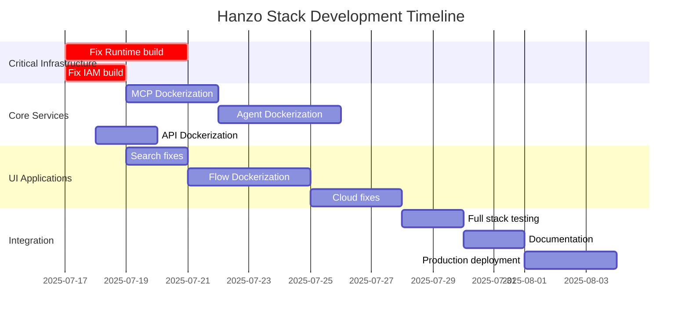

# Hanzo AI Stack - Project Status & Development Timeline 🚀

## Executive Summary

Complete analysis of all Hanzo projects with estimated timelines, dependencies, and resource requirements.

## Current Status Overview

### ✅ Fully Operational Services
| Service | Image Status | Build Status | Notes |
|---------|--------------|--------------|-------|
| Router (LLM Gateway) | ✅ Published | ✅ Working | Using ghcr.io/hanzoai/llm as base |
| Chat | ✅ Published | ✅ Working | LibreChat fork |
| IDE | ✅ Published | ✅ Working | OpenHands fork |
| Analytics | ✅ Published | ✅ Working | Umami fork |
| IAM | ✅ Published | ⚠️ Complex build | Using official Casdoor image |
| Runtime | ✅ Published | ⚠️ Build errors | Minimal placeholder deployed |

### 🔧 Services Needing Work
| Service | Status | Issues | Time Estimate |
|---------|--------|--------|---------------|
| MCP | No Docker | Python package only | 2-3 days |
| Agent | No Docker | Missing Dockerfile | 3-4 days |
| Search | Build errors | Next.js config issues | 1-2 days |
| Flow | No Docker | Complex UI app | 3-4 days |
| Cloud | Build errors | pnpm workspace issues | 2-3 days |
| API | No Docker | FastAPI app | 1-2 days |
| Runtime | Build errors | Missing dependencies | 3-4 days |

## Development Timeline (Gantt Chart Format)

## Detailed Project Analysis

### 1. Runtime Service (CRITICAL - 4 days)
**Issues:**
- Missing OpenTelemetry dependencies
- TypeScript compilation errors
- Complex NX monorepo build

**Tasks:**
- [ ] Fix package.json dependencies
- [ ] Resolve TypeScript errors in tracing.ts
- [ ] Create production-ready Dockerfile
- [ ] Add proper health checks
- [ ] Test with full stack

**Assignee:** Senior Backend Engineer

### 2. IAM Service (CRITICAL - 2 days)
**Issues:**
- Long build times (frontend + backend)
- Multi-stage Docker build timeout
- Architecture-specific binaries

**Tasks:**
- [ ] Optimize Docker build stages
- [ ] Use build cache effectively
- [ ] Create CI/CD pipeline for pre-built images
- [ ] Document configuration

**Assignee:** DevOps Engineer

### 3. MCP Service (HIGH - 3 days)
**Issues:**
- No Dockerfile exists
- Python package distribution
- Claude Desktop integration

**Tasks:**
- [ ] Create multi-stage Dockerfile
- [ ] Package as standalone service
- [ ] Add gRPC/HTTP API layer
- [ ] Create health check endpoint
- [ ] Document MCP tool registration

**Assignee:** Python Developer

### 4. Agent Service (HIGH - 4 days)
**Issues:**
- No Dockerfile
- Complex orchestration logic
- Multi-agent coordination

**Tasks:**
- [ ] Design service architecture
- [ ] Create Dockerfile with all dependencies
- [ ] Implement agent registry
- [ ] Add monitoring/logging
- [ ] Create example agents

**Assignee:** AI/ML Engineer

### 5. Search Service (MEDIUM - 2 days)
**Issues:**
- Next.js build configuration
- Missing environment variables
- Supabase integration

**Tasks:**
- [ ] Fix Next.js config
- [ ] Document all env vars
- [ ] Create docker-compose override
- [ ] Add search provider configs

**Assignee:** Frontend Developer

### 6. Flow Service (MEDIUM - 4 days)
**Issues:**
- No Dockerfile
- Complex UI dependencies
- Workflow persistence

**Tasks:**
- [ ] Create React app Dockerfile
- [ ] Set up workflow storage
- [ ] Implement API endpoints
- [ ] Add authentication
- [ ] Create demo workflows

**Assignee:** Full Stack Developer

### 7. Cloud Service (MEDIUM - 3 days)
**Issues:**
- pnpm workspace errors
- Complex build process
- Missing configurations

**Tasks:**
- [ ] Fix workspace configuration
- [ ] Create proper Dockerfile
- [ ] Set up service mesh
- [ ] Add monitoring dashboards

**Assignee:** Cloud Engineer

### 8. API Service (LOW - 2 days)
**Issues:**
- No Dockerfile
- FastAPI configuration
- Database migrations

**Tasks:**
- [ ] Create FastAPI Dockerfile
- [ ] Set up Alembic migrations
- [ ] Add API documentation
- [ ] Implement auth middleware

**Assignee:** Backend Developer

## Repository-Specific Issues

### `/stack` Repository
- [ ] Add docker-compose.override.yml for local dev
- [ ] Create Makefile for common operations
- [ ] Add health check scripts
- [ ] Document all environment variables
- [ ] Create backup/restore procedures

### `/router` Repository
- [ ] Merge uncommitted changes
- [ ] Update documentation
- [ ] Add more provider configs
- [ ] Implement rate limiting
- [ ] Add custom middleware support

### `/chat` Repository
- [ ] Clean up uncommitted changes
- [ ] Update Hanzo branding
- [ ] Add custom plugins
- [ ] Implement SSO integration

### `/ide` Repository
- [ ] Update configuration
- [ ] Add Hanzo-specific extensions
- [ ] Implement project templates
- [ ] Add debugging tools

## Resource Requirements

### Team Allocation
- **Senior Backend Engineer**: Runtime, API
- **DevOps Engineer**: IAM, Infrastructure
- **Python Developer**: MCP, Agent foundations
- **AI/ML Engineer**: Agent orchestration
- **Frontend Developer**: Search, UI fixes
- **Full Stack Developer**: Flow, integrations
- **Cloud Engineer**: Cloud service, deployments

### Infrastructure Needs
- CI/CD pipeline for automated builds
- Container registry with build caching
- Staging environment for testing
- Monitoring and logging stack
- Backup and disaster recovery

## Success Metrics

1. **Build Success Rate**: 100% of services building successfully
2. **Deployment Time**: < 10 minutes for full stack
3. **Health Check Pass Rate**: 100% services healthy
4. **Documentation Coverage**: 100% services documented
5. **Test Coverage**: > 80% for critical paths

## Next Steps

### Week 1 (Days 1-7)
1. Fix critical services (Runtime, IAM)
2. Start API and MCP dockerization
3. Begin documentation effort

### Week 2 (Days 8-14)
1. Complete Agent service
2. Fix UI applications (Search, Flow, Cloud)
3. Integration testing

### Week 3 (Days 15-21)
1. Full stack testing
2. Performance optimization
3. Production deployment prep
4. Final documentation

## Risk Mitigation

1. **Build Failures**: Use pre-built images as fallback
2. **Dependency Issues**: Pin all versions
3. **Integration Problems**: Incremental testing
4. **Performance**: Load testing before production
5. **Security**: Regular vulnerability scanning

## Estimated Total Timeline: 21 days

With proper resource allocation and parallel development, we can have the entire Hanzo stack production-ready in 3 weeks.

## GitHub Project Integration

Create issues in GitHub Projects:
- Use labels: `critical`, `high`, `medium`, `low`
- Assign to appropriate team members
- Link dependencies between issues
- Track progress with project boards
- Daily standups for coordination

## Communication Plan

1. Daily progress updates in Slack
2. Weekly demo sessions
3. Blocker escalation process
4. Documentation in real-time
5. Code review requirements