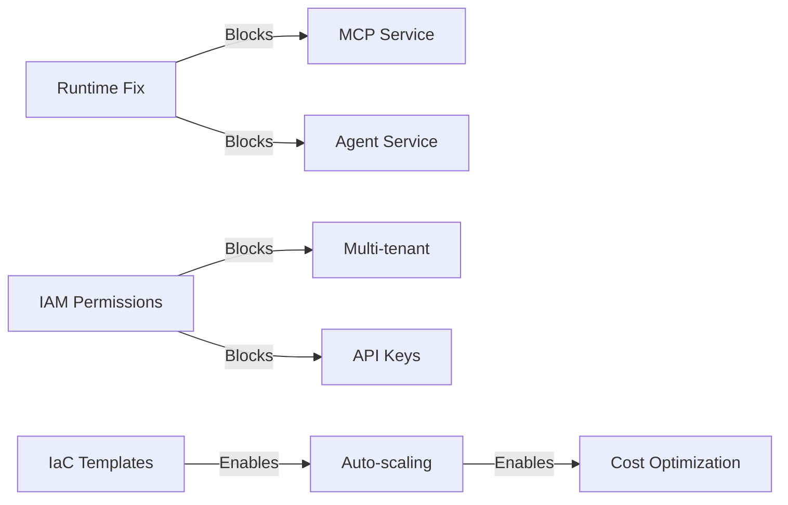
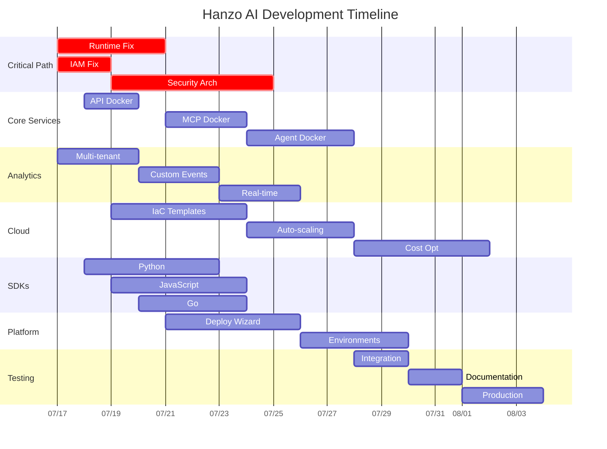

# Hanzo AI Project Tracking Dashboard 📊

## 🎯 Master Project Board
**URL**: https://github.com/orgs/hanzoai/projects/32

## 📈 Current Status (70+ Issues Created)

### By Repository
| Repository | Issues | Status | Progress |
|------------|--------|--------|----------|
| **stack** | 27+ | 🔴 Active | █████░░░░░ 50% |
| **router** | 5+ | 🟡 Started | ██░░░░░░░░ 20% |
| **chat** | 3+ | 🟡 Started | ██░░░░░░░░ 20% |
| **ide** | 3+ | 🟡 Started | ██░░░░░░░░ 20% |
| **mcp** | 2+ | 🟡 Started | █░░░░░░░░░ 10% |
| **agent** | 2+ | 🟡 Started | █░░░░░░░░░ 10% |
| **analytics** | 5+ | 🟢 Active | ███░░░░░░░ 30% |
| **runtime** | 2+ | 🔴 Critical | █░░░░░░░░░ 10% |
| **iam** | 5+ | 🔴 Critical | ██░░░░░░░░ 20% |
| **search** | 2+ | 🟡 Planned | ░░░░░░░░░░ 0% |
| **flow** | 2+ | 🟡 Planned | ░░░░░░░░░░ 0% |
| **cloud** | 4+ | 🟢 Active | ██░░░░░░░░ 20% |
| **python-sdk** | 2+ | 🟢 Active | █░░░░░░░░░ 10% |
| **js-sdk** | 2+ | 🟢 Active | █░░░░░░░░░ 10% |
| **go-sdk** | 1+ | 🟡 Planned | ░░░░░░░░░░ 0% |
| **platform** | 2+ | 🟡 Planned | ░░░░░░░░░░ 0% |
| **team** | 1+ | 🟢 Active | █░░░░░░░░░ 10% |
| **site** | 1+ | 🟢 Active | █░░░░░░░░░ 10% |

### By Priority
- 🔴 **Critical**: 5 issues (Runtime, IAM, Security)
- 🟡 **High**: 35+ issues (Core services, SDKs)
- 🟢 **Medium**: 25+ issues (Features, UI)
- ⚪ **Low**: 5+ issues (Research)

## 📅 Timeline Visualization

### Week 1: Foundation (July 17-23)
```
Mon 17 ████████ Runtime, IAM fixes
Tue 18 ████████ API, Python SDK
Wed 19 ████████ Analytics, JS SDK, Cloud IaC
Thu 20 ████████ MCP, Go SDK
Fri 21 ████████ Search, Flow start
Sat 22 ████░░░░ Review & catch-up
Sun 23 ████░░░░ Documentation
```

### Week 2: Integration (July 24-30)
```
Mon 24 ████████ Agent service
Tue 25 ████████ Auto-scaling
Wed 26 ████████ Platform deployment
Thu 27 ████████ Environment management
Fri 28 ████████ Testing & QA
Sat 29 ████░░░░ Performance tuning
Sun 30 ████░░░░ Cost optimization
```

### Week 3: Production (July 31 - Aug 6)
```
Mon 31 ████████ Security hardening
Tue 01 ████████ Monitoring setup
Wed 02 ████████ Documentation
Thu 03 ████████ Blog content
Fri 04 ████████ Final testing
Sat 05 ████░░░░ Deployment prep
Sun 06 ████░░░░ Go live!
```

## 🔗 Critical Dependencies



## 📊 Gantt Chart (Mermaid)



## 🚀 Quick Actions

### View Issues by Component
- [Stack Issues](https://github.com/hanzoai/stack/issues)
- [Router Issues](https://github.com/hanzoai/router/issues)
- [Analytics Issues](https://github.com/hanzoai/analytics/issues)
- [IAM Issues](https://github.com/hanzo-io/iam/issues)
- [Cloud Issues](https://github.com/hanzoai/cloud/issues)

### Filter Project Board
- [Critical Only](https://github.com/orgs/hanzoai/projects/32?query=is%3Aopen+label%3Apriority%3Acritical)
- [This Week](https://github.com/orgs/hanzoai/projects/32?query=is%3Aopen+milestone%3A%22Week+1%22)
- [Blocked](https://github.com/orgs/hanzoai/projects/32?query=is%3Aopen+label%3Ablocked)

## 📋 Daily Standup Template

```markdown
### Date: [DATE]

**Yesterday**:
- ✅ Completed: [Issue #X, #Y]
- 🚧 In Progress: [Issue #Z]

**Today**:
- 🎯 Focus: [Issue #A]
- 🔧 Continue: [Issue #B]

**Blockers**:
- ⛔ [Blocker description]
- 🔗 Depends on: [Issue #C]

**Metrics**:
- 📊 Issues closed: X/70
- ⏱️ On track: Yes/No
- 💰 Resource usage: X%
```

## 🔧 Automation Setup

### GitHub Actions for Project Management

1. **Auto-add to project**: `.github/workflows/project-add.yml`
2. **Update progress**: `.github/workflows/progress-update.yml`
3. **Daily report**: `.github/workflows/daily-standup.yml`

### Webhooks
- Slack notifications for critical issues
- Email digest of daily progress
- Dashboard updates

## 📱 Mobile Tracking

For mobile access to Gantt charts:
1. **GitHub Mobile**: View project boards
2. **Shortcuts App**: Custom iOS shortcuts
3. **Tasker**: Android automation

## 🎯 Success Criteria

### Week 1 ✓
- [ ] All critical issues resolved
- [ ] Core services dockerized
- [ ] Basic integration working

### Week 2 ✓
- [ ] All services deployed
- [ ] SDKs published
- [ ] Platform automated

### Week 3 ✓
- [ ] Production ready
- [ ] Documentation complete
- [ ] Monitoring active

---

**Last Updated**: July 17, 2025
**Total Issues**: 70+
**Estimated Effort**: 180+ developer days
**Target Completion**: August 6, 2025