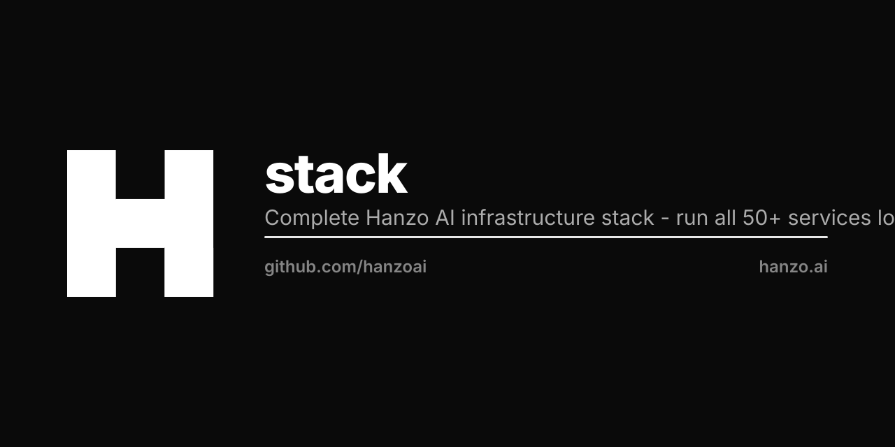

<p align="center"></p>

# Hanzo Stack

OSS quickstart for the Hanzo AI infrastructure. One `docker compose up -d` to spin up the whole platform locally — databases, LLM gateway, chat, search, observability, and supporting services on published images from `ghcr.io/hanzoai/*`.

```bash
git clone https://github.com/hanzoai/stack.git
cd stack
docker compose up -d
```

**For development of Hanzo services themselves, use [`hanzo/universe`](https://github.com/hanzoai/universe) (the mono).**
**For production Kubernetes, use [`hanzo/operator`](https://github.com/hanzoai/operator) (20-CRD k8s operator).**

This repo's root remains the image-only infrastructure quickstart. The optional [FanClub AI reference application](examples/fanclub-ai/README.md) lives under `examples/` and does not alter root Compose or production orchestration.

## What's in it

Just compose files + minimal config. Everything is a published image from `ghcr.io/hanzoai/*`. **No source, no submodules, no build step.**

| Service | Image | Local port |
|---|---|---|
| Postgres | `ghcr.io/hanzoai/sql` | 5432 |
| Redis / KV | `ghcr.io/hanzoai/kv` | 6379 |
| DocDB | `ghcr.io/hanzoai/docdb` | 27017 |
| MinIO | `minio/minio` | 9000 / 9001 |
| Meilisearch | `getmeili/meilisearch` | 7700 |
| Qdrant | `qdrant/qdrant` | 6333 |
| Temporal | `temporalio/auto-setup` | 7233 |
| LLM Gateway | `ghcr.io/hanzoai/llm` | 4000 |
| Chat | `ghcr.io/hanzoai/chat` | 3081 |
| MCP | `ghcr.io/hanzoai/mcp` | varies |
| Agent | `ghcr.io/hanzoai/agent` | varies |
| Runtime | `ghcr.io/hanzoai/runtime` | 8002 |
| Search | `ghcr.io/hanzoai/search` | 3000 |
| IAM | `ghcr.io/hanzoai/iam` | 8000 |
| Cloud | `ghcr.io/hanzoai/cloud` | 3001 |
| Commerce | `ghcr.io/hanzoai/commerce` | 8001 |
| Console | `ghcr.io/hanzoai/console` | 3060 |
| Base | `ghcr.io/hanzoai/base` | 8090 |

See [`compose.yml`](./compose.yml) for the full list. Per-environment overrides in `compose.dev.yml`, `compose.core.yml`, etc.

## Optional reference application — FanClub AI

A fictional, industry-neutral organization intelligence prototype is available at [`examples/fanclub-ai/`](examples/fanclub-ai/README.md). It demonstrates persistent synthetic records, three independent tenant workspaces, decision baselines, human-approved simulated actions, audit and optional private Hanzo Engine inference.

```bash
cd examples/fanclub-ai
npm start       # Node.js 22.13+, no Docker required
npm test        # synthetic-data / tenant-boundary tests
```

**This is an isolated demonstrator, not a production-integrated Hanzo service.** Its demo SQLite and tenant selector must be replaced by authenticated Hanzo Cloud + Framework/Base + IAM; see [integration plan](examples/fanclub-ai/docs/hanzo-integration.md). It uses no live customer data and sends no external actions. Core infrastructure remains the published-image quickstart described below.

## Configuration

Copy the example env file and edit:

```bash
cp .env.example .env
```

The only values you typically need to set for a quickstart are API keys for the LLM gateway:

```
OPENAI_API_KEY=sk-...
ANTHROPIC_API_KEY=sk-ant-...
```

Database credentials, ports, etc. all default sensibly.

## Pinning versions

The default compose uses `:latest`. For anything beyond quickstart, override in your own `compose.override.yml`:

```yaml
services:
  llm:
    image: ghcr.io/hanzoai/llm:v1.42.0
  chat:
    image: ghcr.io/hanzoai/chat:v0.7.3
```

Or fork this repo and pin to whatever semver you want.

## Profiles

```bash
docker compose up -d                                       # everything
docker compose -f compose.yml -f compose.core.yml up -d    # databases + LLM + chat
docker compose -f compose.yml -f compose.dev.yml up -d     # dev-ergonomic ports + volumes
```

## Going beyond the quickstart

This stack is intentionally simple. If you need:

| Need | Use instead |
|---|---|
| Develop / modify a Hanzo service | [`hanzo/universe`](https://github.com/hanzoai/universe) — the mono with full source |
| Run in production Kubernetes | [`hanzo/operator`](https://github.com/hanzoai/operator) — 20-CRD operator (Service, Datastore, SQL/KV/DocDB/S3 facades, Gateway, MPC, Network, Ingress, DNS, more) |
| Run in production PaaS | [`platform.hanzo.ai`](https://platform.hanzo.ai) — Dokploy-based PaaS, deploys from git |
| Multi-tenant SQLite + extension runtimes | [`hanzo/base`](https://github.com/hanzoai/base) — embedded in every Hanzo Go service |
| LLM gateway only | [`hanzo/llm`](https://github.com/hanzoai/llm) — 100+ providers, OpenAI-compatible |
| Identity (OAuth/OIDC/SAML) | [`hanzo/iam`](https://github.com/hanzoai/iam) |
| Observability | [`hanzo/console`](https://github.com/hanzoai/console) (traces/scores/prompts) + [`hanzo/o11y`](https://github.com/hanzoai/o11y) |

## Troubleshooting

```bash
docker compose logs <service-name>      # logs
docker compose restart <service-name>   # restart one service
docker compose down -v                  # nuke everything, including volumes
```

## License

MIT. See [LICENSE](./LICENSE).
