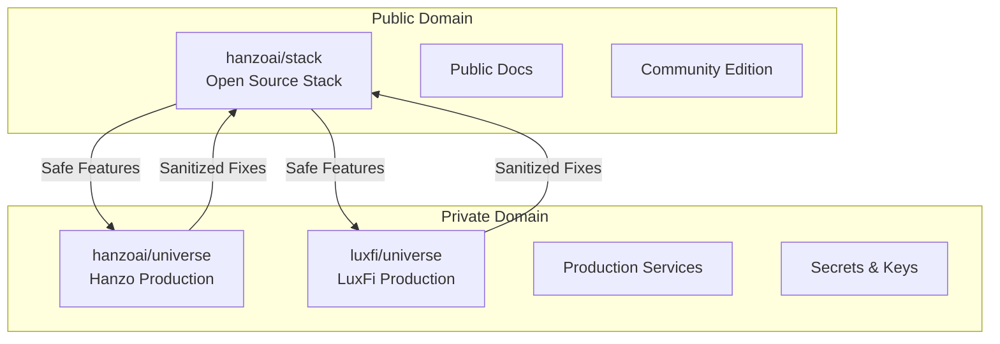

# Stack Architecture - Public vs Private Separation

## Overview

We maintain a clean separation between public open-source components and private production systems:



## Repository Structure

### 1. Public Stack (`github.com/hanzoai/stack`)
**Purpose**: Open-source distribution for community use

**Contains**:
- Core infrastructure components
- Docker Compose configurations
- Example environment files
- Public documentation
- Integration tests
- CI/CD workflows

**Does NOT contain**:
- Production secrets
- Customer data handlers
- Payment processing code
- Proprietary algorithms
- Production configurations
- Internal service endpoints

### 2. Hanzo Universe (`github.com/hanzoai/universe`)
**Purpose**: Private production environment for Hanzo AI services

**Contains**:
- All public stack components
- Private microservices
- Production configurations
- Customer-specific features
- Billing and payment systems
- Analytics and telemetry
- Production secrets (encrypted)

**Additional Features**:
- Multi-tenant support
- Advanced monitoring
- Custom integrations
- Enterprise features
- Production-grade security

### 3. LuxFi Universe (`github.com/luxfi/universe`)
**Purpose**: Financial services and DeFi production stack

**Contains**:
- Financial trading engine
- Custody services
- Compliance systems
- Blockchain integrations
- Smart contracts
- Regulatory reporting
- HSM configurations

**Specialized for**:
- High-frequency trading
- Digital asset custody
- Cross-chain operations
- Regulatory compliance
- Financial monitoring

## Sync Workflows

### Public → Private
```bash
# Automated daily sync
.github/workflows/sync-from-public.yml

# Manual sync
git fetch public main
git merge public/main --strategy=ours
git checkout public/main -- safe-files/
```

### Private → Public
```bash
# Create sanitized branch
git checkout -b public-contribution

# Cherry-pick safe commits
git cherry-pick <commit-hash>

# Remove sensitive data
git filter-branch --tree-filter 'rm -rf secrets/' HEAD

# Create PR to public repo
gh pr create --repo hanzoai/stack
```

## Security Boundaries

### Public Stack Security
- Example credentials only
- No real API endpoints
- Sanitized error messages
- Basic authentication examples
- Community-safe defaults

### Private Universe Security
- Production credentials in HashiCorp Vault
- Customer data encryption at rest
- TLS 1.3 for all services
- Zero-trust networking
- SOC 2 compliance
- GDPR compliance

## Development Workflow

### For Public Contributors
1. Fork `hanzoai/stack`
2. Create feature branch
3. Submit PR with tests
4. Sign CLA
5. Get review from maintainers

### For Internal Team
1. Work in universe repos
2. Test in staging environment
3. Get security review
4. Deploy to production
5. Backport safe changes to public

## Feature Management

### Public Features
- ✅ Core infrastructure
- ✅ Basic authentication
- ✅ Standard monitoring
- ✅ Community plugins
- ✅ Example configurations

### Private Features
- 🔒 Enterprise SSO
- 🔒 Advanced analytics
- 🔒 Custom integrations
- 🔒 Priority support
- 🔒 SLA guarantees

## Migration Path

### From Public to Private
```bash
# Start with public stack
git clone https://github.com/hanzoai/stack
cd stack
docker compose up -d

# Upgrade to private universe
git remote add universe git@github.com:hanzoai/universe
git fetch universe
git checkout universe/main

# Apply production configs
cp .env.production.example .env
docker compose -f compose.yml -f compose.production.yml up -d
```

## Maintenance Strategy

### Public Stack
- Quarterly releases
- Security patches monthly
- Community contributions welcome
- Public roadmap
- Open issue tracking

### Private Universe
- Continuous deployment
- Daily security scans
- Internal only changes
- Private roadmap
- Internal issue tracking

## Best Practices

### When to Use Public Stack
- Development and testing
- Learning and evaluation
- Community projects
- Open-source applications
- Non-critical workloads

### When to Use Private Universe
- Production deployments
- Customer data processing
- Financial transactions
- Regulatory compliance
- Mission-critical services

## Contribution Guidelines

### Contributing to Public
1. Check existing issues
2. Discuss major changes
3. Follow code style
4. Add tests
5. Update documentation

### Contributing to Private
1. Internal review required
2. Security assessment
3. Compliance check
4. Performance testing
5. Production approval

## Support Model

### Public Stack Support
- GitHub issues
- Community Discord
- Stack Overflow
- Documentation wiki
- Best effort response

### Private Universe Support
- 24/7 on-call
- Dedicated Slack
- Priority escalation
- SLA guarantees
- Professional services

## Conclusion

This architecture ensures:
- **Security**: Private data stays private
- **Openness**: Community benefits from core features
- **Maintainability**: Clear separation of concerns
- **Scalability**: Independent evolution of public/private
- **Compliance**: Regulatory requirements isolated

By maintaining this separation, we can:
- Share innovations with the community
- Protect customer data and IP
- Scale both platforms independently
- Maintain security and compliance
- Foster open-source collaboration